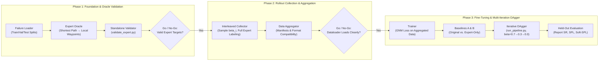

# Iterative DAgger Implementation Plan for ObjectReact Failure Recovery (Revised)

**Project:** Object-Relative Visual Navigation  
**Target Directory:** `dagger/`  
**Reference Document:** `dagger/experiment_1`  
**Objective:** Build an end-to-end, iterative Dataset Aggregation (DAgger) pipeline with expert interleaving to improve ObjectReact policy recovery from navigation failures, with strict target alignment, standalone oracle validation, and controlled baselines.

---

## Architecture & Directory Layout

```
dagger/
├── experiment_1                  # Existing experiment design specification
├── plan.md                       # This revised implementation plan
├── config.yaml                   # Global hyperparameters, paths, iteration schedule, splits
│
├── core/                         # Reusable core modules
│   ├── failure_loader.py         # Parses failure states (pose, yaw, scene, goal) with train/val/test splits
│   ├── expert_oracle.py          # Habitat navigation mesh shortest-path oracle + ObjectReact action mapping
│   ├── rollout_collector.py      # Interleaved rollout runner sampling execution via beta_i with full expert labeling
│   ├── data_aggregator.py        # Aggregates D_agg = D_agg ∪ D_i in GNM format with versioned manifests
│   └── trainer.py                # Fine-tunes ObjectReact policy using the native training loss & loader
│
├── validate_expert.py            # Standalone oracle validation milestone on sample failure cases
├── evaluate_recovery.py          # Evaluates student policy autonomously (beta=0) on held-out recovery tasks
├── run_iteration.py              # Executes a single DAgger iteration (collect -> aggregate -> train -> eval)
└── run_pipeline.py               # Master orchestrator running baselines and iterative DAgger end-to-end
```

---

## Essential Principles & Design Constraints

### 1. Target Format & Action Space Compatibility
Habitat's navmesh pathfinder produces raw 3D geodesic paths $(x, y, z)$. ObjectReact expects a trajectory rollout prediction of length $T=10$ or $5$ in local egocentric coordinates:
- **Positions:** Transformed via `to_local_coords(positions, curr_pos, curr_yaw)`.
- **Angles:** Yaw delta $\Delta \text{yaw} = \text{yaw}_{1:} - \text{yaw}_0$ (when `learn_angle` is enabled).
- **Normalization:** Divided by metric waypoint spacing scale factors matching `vint_dataset.py`.
The oracle must compute this exact representation so that training targets are identical to the original supervision signal.

### 2. Standalone Expert Validation Milestone (`validate_expert.py`)
Before implementing rollout collection, we must verify that:
1. Habitat pathfinder generates collision-free routes from failure poses.
2. The path waypoints convert cleanly into ObjectReact-compatible action tensors.
3. Computed expert actions align with student coordinate frames and normalization constants.
4. Edge cases (unnavigable poses, snapping, occlusion) are flagged as query failures rather than corrupt training targets.

### 3. Preserving the Original Evaluation Criterion
The goal distance threshold must **not** be arbitrarily hardcoded. It directly inherits `threshold_goal_distance` from the original task configuration (default in `configs/defaults.yaml` / `configs/object_react.yaml`), ensuring recovery metrics remain directly comparable to the benchmark evaluation without artificial inflation.

### 4. Precise DAgger Intervention & Labeling Semantics
In each iteration $i$, $\beta_i$ controls **who executes the action**, while the expert **always provides the ground-truth label** for every valid visited state:

| Iteration | Expert Acts ($\beta_i$) | Student Acts ($1 - \beta_i$) | Expert Labels Recorded |
|:---:|:---:|:---:|:---:|
| **0** (Early) | 70% | 30% | 100% of visited states |
| **1** (Intermediate) | 30% | 70% | 100% of visited states |
| **2** (Autonomous Collection) | 0% | 100% | 100% of visited states |

Even at $\beta=0$, the expert supplies targets for the student-induced distribution.

### 5. Leakage Prevention (Train / Val / Held-Out Splits)
To ensure generalizable recovery rather than overfitting to specific failure coordinates:
- **Recovery-Train Set:** Used for rollout collection and policy fine-tuning.
- **Validation Set:** Used for tuning hyperparameters ($\beta$, learning rate, epochs).
- **Held-Out Test Set:** Distinct failure cases (partitioned by scenes where feasible) evaluated strictly at test time.

### 6. Controlled Baselines
To verify that gains stem from visiting student-induced states rather than merely seeing additional recovery data:
- **Baseline A:** Original ObjectReact checkpoint, evaluated on recovery cases (no fine-tuning).
- **Baseline B (Expert Demonstrations Only):** Fine-tuned on recovery rollouts collected purely with $\beta=1.0$.
- **Experiment 1 (DAgger):** Fine-tuned on expert-interleaved rollouts ($\beta \in [0.7, 0.3, 0.0]$).

---

## 3-Phased Execution Plan



---

### Phase 1: Foundation & Expert Oracle Validation

**Goal:** Inspect data formats, parse failure metadata, build the shortest-path oracle, and validate expert targets on sample failure cases before any rollouts are collected.

1. **`dagger/config.yaml`**:
   - Model paths, dataset paths, scene splits.
   - Goal threshold (matching original task config).
   - Iteration schedule $\beta = [0.7, 0.3, 0.0]$.
   - Local coordinate normalization and metric waypoint spacing constants from `vint_dataset.py`.

2. **`dagger/core/failure_loader.py`**:
   - Parses recorded failure cases from evaluation logs/metadata.
   - Extracts: `episode_name`, `scene_id`, failure pose $(x_f, y_f, z_f)$, orientation quaternion / yaw, goal pose $(x_g, y_g, z_g)$, and initial geodesic distance.
   - Partitions failures into **Train**, **Validation**, and **Held-Out Test** splits (split by scene ID to avoid leakage).

3. **`dagger/core/expert_oracle.py`**:
   - Queries Habitat `sim.pathfinder.find_path`.
   - Snaps unnavigable points via `sim.pathfinder.snap_point`.
   - Extracts lookahead waypoints and transforms them into local robot coordinates using `to_local_coords` and yaw rotation matrices.
   - Formats targets into normalized action rollouts identical to ObjectReact's loss function.

4. **`dagger/validate_expert.py` (Standalone Milestone)**:
   - Loads a handful of failure cases across different scenes.
   - Runs the oracle, prints and visualizes generated action rollouts, checks norms, headings, and coordinate orientations.
   - **Go / No-Go Gate 1:** Valid expert targets agreeing with ObjectReact's target conventions.

---

### Phase 2: Rollout Collection & Dataset Aggregation

**Goal:** Implement expert interleaving, label visited states, format data for the existing training loader, and verify aggregation integrity.

1. **`dagger/core/rollout_collector.py`**:
   - Spawns Habitat-Sim at failure state $(s_f, \text{yaw}_f)$ targeting original goal $g$.
   - Step loop:
     - Obtains student action $\pi_{\theta_i}(s_t)$.
     - Queries expert oracle $a_t^* = \pi^*(s_t, g)$.
     - Samples executed action $a_t \sim \text{Bernoulli}(\beta_i)$.
     - Steps simulation and logs tuple: $(s_t, \text{obs\_context}, \text{goal\_mask}, a_t^*)$.
   - Continues rollout until reaching goal threshold or max step budget.

2. **`dagger/core/data_aggregator.py`**:
   - Organizes collected samples into `dagger/data/iter_{i}/samples/`.
   - Emits versioned manifests: `dagger/data/manifests/iter_{i}.csv` tracking sample ID, episode source, iteration index, and action source (expert vs student).
   - Merges manifests: $\mathcal{D}_{\text{agg}}^{(i+1)} = \mathcal{D}_{\text{agg}}^{(i)} \cup \mathcal{D}_i$.
   - Prevents duplicate aggregation upon restarts.

3. **Dataset Loader Verification**:
   - Passes newly collected recovery data through the native GNM/ObjectReact dataloader (`vint_dataset.py`) to confirm shapes, normalization, and absence of NaN/infinite values.
   - **Go / No-Go Gate 2:** Aggregated dataset loads and validates through the model cleanly.

---

### Phase 3: Fine-Tuning, Baselines & Iterative Pipeline

**Goal:** Train policies, run controlled baselines, execute the multi-iteration DAgger schedule, and evaluate held-out recovery performance.

1. **`dagger/core/trainer.py`**:
   - Fine-tunes ObjectReact policy on $\mathcal{D}_{\text{agg}}$ using the native GNM waypoint MSE loss.
   - Supports training from scratch or fine-tuning from base checkpoint.
   - Checkpoints saved to `dagger/checkpoints/policy_iter_{i}.pth`.

2. **`dagger/evaluate_recovery.py`**:
   - Evaluates a given checkpoint autonomously ($\beta = 0$, student in control) on the held-out failure evaluation set.
   - Computes:
     - **Recovery Success Rate (R-SR)**.
     - **Path-weighted efficiency (R-SPL)** and **Soft-SPL**.
     - **Distance Closed** to target goal.

3. **Controlled Baselines & Iterative DAgger (`run_pipeline.py`)**:
   - **Baseline A:** Evaluate base ObjectReact checkpoint $\pi_{\theta_0}$ on recovery cases.
   - **Baseline B:** Train and evaluate on expert-only demonstrations ($\beta=1.0$).
   - **DAgger Iterations:**
     - Iteration 0: Collect rollouts with $\beta=0.7$, aggregate, fine-tune $\rightarrow \pi_{\theta_1}$, evaluate.
     - Iteration 1: Collect rollouts with $\beta=0.3$, aggregate, fine-tune $\rightarrow \pi_{\theta_2}$, evaluate.
     - Iteration 2: Collect rollouts with $\beta=0.0$, aggregate, fine-tune $\rightarrow \pi_{\theta_3}$, evaluate.
   - Generates summary report comparing **Baseline A vs. Baseline B vs. DAgger Iterations 1–3**.
   - **Go / No-Go Gate 3:** Statistically significant recovery improvement on held-out cases over both Baseline A and Baseline B.

---

## Execution Checklist

- [x] **Phase 1: Foundation & Oracle**
  - [x] Write `dagger/config.yaml`
  - [x] Implement `dagger/core/failure_loader.py`
  - [x] Implement `dagger/core/expert_oracle.py`
  - [x] Validate oracle targets on failure cases via `dagger/validate_expert.py` (Gate 1 Passed)
  - [x] Implement `dagger/evaluate_recovery.py`
- [x] **Phase 2: Interleaved Rollout & Aggregation**
  - [x] Implement `dagger/core/rollout_collector.py`
  - [x] Implement `dagger/core/data_aggregator.py`
  - [x] Validate pilot rollout & dataset generation (Gate 2 Passed)
- [ ] **Phase 3: Fine-Tuning & Iterative Orchestration**
  - [ ] Implement `dagger/core/trainer.py`
  - [ ] Implement `dagger/run_iteration.py`
  - [ ] Implement `dagger/run_pipeline.py`
  - [ ] Run end-to-end validation across multiple iterations (Gate 3)
