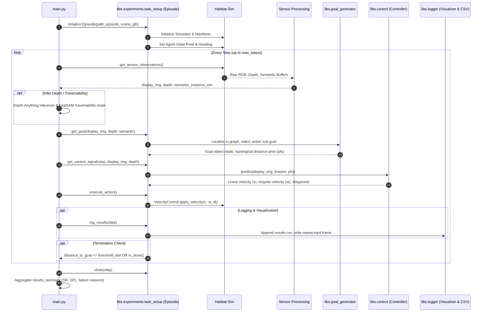
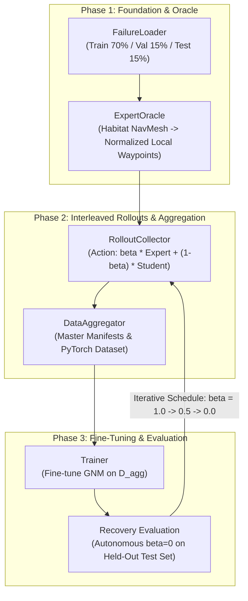

# Object-Relative Visual Navigation: Comprehensive Repository Knowledge Base

**Date:** October 2026  
**Repository:** `gakshat365/ak-object-rel-nav`  
**Location:** `/scratch2/akshat.gupta/ak-object-rel-nav`  
**Core Frameworks & Benchmark Papers:**
- **ObjectReact** (*CoRL 2025*): *Learning Object-Relative Control for Visual Navigation*
- **TANGO** (*ICRA 2025*): *Traversability-Aware Navigation with Local Metric Control for Topological Goals*
- **RoboHop** (*ICRA 2024*): *Segment-based Topological Map Representation for Open-World Visual Navigation*

---

## Table of Contents
1. [Executive Summary & Global Architecture](#1-executive-summary--global-architecture)
2. [End-to-End Simulation & Navigation Runtime (`main.py`)](#2-end-to-end-simulation--navigation-runtime-mainpy)
3. [Deep Analysis of Training Scripts](#3-deep-analysis-of-training-scripts)
4. [Deep Analysis of Evaluation Scripts](#4-deep-analysis-of-evaluation-scripts)
5. [Comprehensive Data Ecosystem Analysis](#5-comprehensive-data-ecosystem-analysis)
6. [Deep Dive: The `old_dagger` Pipeline vs Modern `dagger`](#6-deep-dive-the-old_dagger-pipeline-vs-modern-dagger)
7. [Deep Analysis of Visualisation Scripts & Telemetry Suite](#7-deep-analysis-of-visualisation-scripts--telemetry-suite)
8. [The `SafeTurnController` & Kinematic Steering Analysis](#8-the-safeturncontroller--kinematic-steering-analysis)
9. [Operational Cheat Sheet & Reproduction Commands](#9-operational-cheat-sheet--reproduction-commands)

---

## 1. Executive Summary & Global Architecture

### 1.1 Research Context & Objectives
The repository serves as an integrated experimental and benchmarking platform for object-relative visual navigation controllers operating inside photo-realistic 3D indoor environments (Habitat-Matterport 3D / HM3D). 

Traditional visual navigation approaches (e.g., ImageNav or PointNav) often rely on end-to-end black-box policies or dense metric reconstruction. This codebase embodies a hybrid paradigm:
1. **Topological Object Graphs (RoboHop & TANGO):** Multi-view scene representations where nodes represent segmented object instances (segmented via FastSAM, SAM, or SAM2) and edges encode spatial/topological relations and traversability.
2. **Object-Relative Waypoint Planning (ObjectReact):** A reactive goal-conditioned visual policy (based on General Navigation Models / GNM and ViNT) that consumes first-person RGB observations alongside object segmentation masks and geodesic distance priors (`pls`), producing future local waypoint trajectories $[(x_1, y_1), \dots, (x_{10}, y_{10})]$.
3. **Traversability & Metric Safety (TANGO & SafeTurnController):** Real-time safety shielding, depth inference (via Depth-Anything), and obstacle clearance mechanisms to prevent collisions and wall-facing deadlocks.
4. **Dataset Aggregation for Failure Recovery (DAgger):** An active learning pipeline designed to systematically diagnose, trace, and unstick failure trajectories where the policy collides, stagnates, or times out.

### 1.2 Top-Level Repository Map

```
ak-object-rel-nav/
├── main.py                             # Master navigation episode execution engine
├── evaluate_objectreact.py              # Root benchmark evaluation script (SR, SPL, Soft-SPL)
├── configs/                            # System configurations
│   ├── defaults.yaml                   # Global default hyperparameters & episode blacklists
│   ├── object_react.yaml               # ObjectReact controller & experiment configuration
│   ├── tango.yaml                      # TANGO traversability-aware controller configuration
│   └── controller/
│       └── object_react_controller.yaml# GNM policy architecture parameters
├── libs/                               # Core modular library
│   ├── common/                         # Shared math, geometry, sensor & visualization tools
│   ├── control/                        # Navigation controllers (ObjectReact, SafeTurn, RoboHop, TANGO)
│   │   ├── object_react/               # Submodule: training framework (GNM, ViNT, NoMaD)
│   │   ├── objectreact.py              # ObjRelLearntController runtime wrapper
│   │   ├── safe_controller.py          # Adaptive SafeTurnController (v3)
│   │   └── robohop.py                  # Mask-based visual servomechanism
│   ├── depth/                          # Metric depth estimators (Depth-Anything)
│   ├── experiments/                    # Task setup, episode lifecycle & model loading
│   ├── goal_generator/                 # Topological, metric, & object-relative goal selection
│   ├── localizer/                      # Visual topological localizers (LightGlue, SuperPoint)
│   ├── logger/                         # Telemetry, video recording, & WandB logging
│   ├── mapper/                         # Graph building & topological map generation
│   ├── matcher/                        # Keypoint and instance matchers
│   ├── pixnav/                         # Pixel-level navigation baseline
│   ├── planner_global/                 # Dijkstra, geodesic, & topological graph planners
│   ├── segmentor/                      # Instance segmentation models (FastSAM, SAM2)
│   └── tracker/                        # Visual object tracking
├── dagger/                             # Modern DAgger pipeline with backward failure recovery
│   ├── config.yaml                     # DAgger iterations, thresholds, and paths
│   ├── extract_failed_cases.py         # Evaluates policy, detects stagnation & backtracks
│   ├── generate_training_data.py       # Procedural multi-modal trajectory generator from HM3D
│   ├── core/
│   │   ├── failure_detector.py         # Stagnation monitor & BackwardFailureTracer
│   │   ├── expert_oracle.py            # Habitat NavMesh shortest-path oracle
│   │   └── rollout_collector.py        # Interleaved student-expert rollout runner
│   └── model/baseline_model/           # Pretrained GNM model weights and configs
├── old_dagger/                         # Established, evaluated iterative DAgger recovery framework
│   ├── config.yaml                     # Hyperparameters, beta schedule, simulation parameters
│   ├── experiment_1                    # Formal experimental design document
│   ├── plan.md                         # 3-phase execution checklist and gating plan
│   ├── run_pipeline.py                 # Full pipeline orchestrator (Baselines A/B + DAgger iters)
│   ├── run_iteration.py                # Single iteration runner (collect -> aggregate -> train -> eval)
│   ├── evaluate_recovery.py            # Autonomous recovery evaluation (beta = 0)
│   ├── evaluate_comparison.py          # Baseline vs SafeTurnController head-to-head comparison
│   ├── visualize_comparison_video.py   # Synchronized 4-way 1080p comparison video generator
│   ├── core/
│   │   ├── failure_loader.py           # Parses failure states with scene-isolated train/val/test splits
│   │   ├── expert_oracle.py            # Habitat pathfinder to local normalized waypoint mapper
│   │   ├── rollout_collector.py        # Rollout collection with scene caching & RAM buffering
│   │   ├── data_aggregator.py          # Versioned manifest tracker & PyTorch DAggerRecoveryDataset
│   │   └── trainer.py                  # GNM fine-tuner on aggregated recovery data
│   ├── checkpoints/                    # Saved policies: policy_iter_-1.pth (BC), 0, 1, 2.pth
│   ├── data/                           # Manifests, sample bundles, and 10GB tensor caches
│   └── logs/                           # Telemetry reports, JSON evaluations, and pipeline results
├── visualisations/                     # Perception analysis & telemetry suite
│   ├── rerun_all_failure_episodes.py   # Sequential replay benchmark of 338 failure episodes
│   ├── compile_failure_videos.py       # Stitches 338 failure videos with custom 2.5s title cards
│   ├── visualize_traversability_analysis.py # 5-panel 1080p traversability dashboard
│   ├── episode_mapping.json / .csv     # Master registry of 338 evaluated failure episodes
│   └── failure_episodes_compilation_all338.mp4 # 817MB stitched compilation video
├── scripts/                            # Operational utility scripts
│   ├── create_maps_hm3d.py             # Offline topological graph creator from reference frames
│   ├── evaluate_objecreact.py          # Evaluates ObjectReact output directories
│   ├── evaluate_tango.py               # Evaluates TANGO collision & distance histograms
│   └── test_one_ep.py                  # Minimal 10-step sanity test script
├── data/                               # Dataset symlinks and synthetic data storage
├── out/                                # Experiment logs, evaluation metrics, and recordings
└── model_weights/                      # Checkpoints (FastSAM-s.pt, etc.)
```

---

## 2. End-to-End Simulation & Navigation Runtime (`main.py`)

`main.py` is the primary entry point for executing evaluation and navigation episodes in Habitat-Sim.



### 2.1 Sensor Observation & Split Pipeline
In lines 115–124 of `main.py`, the simulation queries agent sensors:
- **RGB Camera:** $320 \times 240$, $120^\circ$ Horizontal Field of View (HFOV), sensor height $0.4\text{ m}$ (or $1.31\text{ m}$ for mapping).
- **Depth Sensor:** Ground-truth depth from Habitat-Sim or inferred via Depth-Anything metric base ViT model (`preload_data["depth_model"].infer(display_img) * 0.44`).
- **Semantic Sensor:** Instance segmentations mapping pixel values to HM3D semantic IDs.
- **Traversability Processing:** When `infer_traversable=True`, FastSAM identifies walkable floor classes (`floor`, `flooring`, `carpet`, `rug`, `ground`, `tiles`).

### 2.2 Task Modes
The system supports three distinct evaluation tasks (defined in ObjectReact):
1. **Original ("Imitate"):** Robot starts at the beginning of the reference human demonstration trajectory and must navigate to the end goal.
2. **AltGoal ("Alternative Goal"):** Robot must navigate to an alternative semantic goal of the same category in a different location.
3. **ViaAltGoal ("Shortcut"):** Robot must find a shortcut path connecting topological segments via an intermediate goal.

---

## 3. Deep Analysis of Training Scripts

The training architecture resides in the submodule at `libs/control/object_react/train/` with supplementary fine-tuning scripts in `old_dagger/core/trainer.py` and data generation in `dagger/generate_training_data.py`.

### 3.1 Primary Training Engine (`libs/control/object_react/train/train.py`)

#### Model Architectures Supported
`train.py` interfaces with three model architectures derived from the General Navigation Model (GNM) lineage:
1. **GNM (Default for ObjectReact):** Dual MobileNetV2 or ResNet encoders.
   - Observation context encoder: Encodes past $K=5$ RGB frames.
   - Goal encoder: Encodes goal image or object segmentation mask representation (`image_mask_enc`).
   - Fusion MLP: Predicts $T=10$ future waypoint coordinates $[(\hat{x}_t, \hat{y}_t)]_{t=1}^{10}$ and optional topological distance $\hat{d}$.
2. **ViNT (Visual Navigation Transformer):** Vision Transformer (ViT) backbones with Multi-Head Attention (MHA) cross-fusion layers.
3. **NoMaD (Non-Modular Navigation & Diffusion):** Employs a Conditional 1D Diffusion Policy (U-Net) to handle multi-modal trajectory distributions.

#### Dataset Pipeline & Data Loading
`ready_dataloaders()` in `train.py` builds an end-to-end multi-robot dataloader via `ViNT_Dataset`:
- **Context Handling (`context_type: temporal`):** Samples consecutive observations $[I_{t-K+1}, \dots, I_t]$ with $K=5$.
- **Action Sampling Horizon:** Waypoints are extracted at metric spacings $d = 0.5\text{ m}$ over lookahead horizons $T=10$ ($5.0\text{ m}$ total lookahead).
- **Goal Types:**
  - `image_mask_enc`: Observation image with masked object representation and positional encodings.
  - `disabled`: Goal conditioning disabled (pure exploration).
  - `image`: Conventional visual goal image.
- **Positional Encoding & Normalization:** Object masks are processed by generating sinusoidal positional encodings concatenated with normalized path lengths (`normalize_pls`).

#### Multi-Task Loss Formulation
The objective function optimizes a convex combination of action trajectory prediction loss and topological distance estimation loss:

$$\mathcal{L}_{\text{total}} = \mathcal{L}_{\text{action}} + \alpha \cdot \mathcal{L}_{\text{dist}}$$

1. **Action Waypoint Loss ($\mathcal{L}_{\text{action}}$):**
   $$\mathcal{L}_{\text{action}} = \frac{1}{T} \sum_{t=1}^{T} \left( \|\hat{\mathbf{w}}_t - \mathbf{w}_t^*\|_2^2 + \lambda_{\text{angle}} \cdot \|\Delta \hat{\theta}_t - \Delta \theta_t^*\|_2^2 \right)$$
   where $\mathbf{w}_t = (x_t, y_t)$ are planar 2D coordinates in local robot frame, $\Delta \theta_t$ is the relative yaw heading delta, and $\lambda_{\text{angle}}$ is active when `learn_angle: True`.

2. **Distance Prediction Loss ($\mathcal{L}_{\text{dist}}$):**
   $$\mathcal{L}_{\text{dist}} = \text{MSE}(\hat{d}, d^*)$$
   where $d^*$ is the geodesic or topological hop distance to the active sub-goal. In standard ObjectReact training, $\alpha = 0.5$.

#### Optimization & Learning Rate Scheduling
- **Optimizers:** Adam ($\beta_1=0.9, \beta_2=0.98$), AdamW, or SGD.
- **Schedulers:** Cosine Annealing, CyclicLR, or GradualWarmupScheduler.
- **Gradient Clipping:** Strict clamping via `torch.clamp(grad, -max_norm, max_norm)` (typically `max_norm: 1.0`).

### 3.2 DAgger Fine-Tuning Engine (`old_dagger/core/trainer.py`)
`DAggerTrainer` fine-tunes the base ObjectReact GNM model strictly on the recovery distribution $\mathcal{D}_{\text{agg}}$:
- **Focused Objective:** Only the action waypoint MSE loss is minimized ($\alpha = 0.0$), eliminating gradient conflict from the distance prediction head during recovery.
- **Input Transformation:** Custom torchvision normalizations (`mean=[0.485, 0.456, 0.406]`, `std=[0.229, 0.224, 0.225]`).
- **Checkpointing:** Automatically tracks validation loss and preserves both iteration checkpoints (`policy_iter_{i}.pth`) and best validation snapshots (`policy_iter_{i}_best.pth`).

### 3.3 Synthetic Trajectory Generator (`dagger/generate_training_data.py`)
A standalone generator that builds synthetic demonstration datasets directly from raw HM3D 3D meshes without human teleoperation:
1. **Scene Semantic Mining:** Discovers all semantic object instances (chairs, beds, sofas, tv_monitors, plants, toilets, tables).
2. **Navigable Interaction Sampling:** Computes interaction bounding boxes and identifies collision-free, walkable stand points within $[1.0\text{m}, 2.5\text{m}]$ of the target object.
3. **Geodesic Path Generation:** Samples random navigable start locations at controlled distances (Easy: 3–5m, Medium: 5–8m, Hard: 8–15m) and queries Habitat's shortest path solver.
4. **Autonomous Trajectory Stepping:** Steps an agent along the path, rendering first-person RGB images ($320\times 240$, $120^\circ$ HFOV), 10-step future local waypoint tensors $[x, y, \cos\theta, \sin\theta]$, geodesic cost maps, and top-down floorplan maps.

---

## 4. Deep Analysis of Evaluation Scripts

### 4.1 Master Benchmark Evaluator (`evaluate_objectreact.py`)

#### Mathematical Metrics Computed
Given an episode $i$ with shortest geodesic path length $L_i^*$, actual traversed path length $P_i$, and remaining distance to goal $d_i$:

1. **Success Rate (SR):**
   $$\text{SR} = \frac{1}{N} \sum_{i=1}^{N} S_i, \quad S_i = \mathbb{I}(d_i \le d_{\text{thresh}}), \quad d_{\text{thresh}} = 1.0\text{ m}$$

2. **Success weighted by Path Length (SPL):**
   $$\text{SPL} = \frac{1}{N} \sum_{i=1}^{N} S_i \frac{L_i^*}{\max(L_i^*, P_i)}$$

3. **Soft-SPL (Continuous Progress Efficiency):**
   $$\text{Soft-SPL} = \frac{1}{N} \sum_{i=1}^{N} \max\left(0, 1 - \frac{d_i}{L_i^*}\right)$$
   For successful episodes ($S_i = 1$), Soft-SPL evaluates to $1.0$. For incomplete runs, it awards partial credit proportional to progress made toward the goal.

4. **Collision Metric:**
   $$\bar{C} = \frac{1}{N_{\text{success}}} \sum_{i \in \text{Success}} \frac{1}{T_i} \sum_{t=1}^{T_i} \mathbb{I}(\text{collision}_t)$$

#### Episode Blacklisting Architecture
In lines 18–20 and 63–68 of `evaluate_objectreact.py`, episodes with corrupted ground truths, invalid start states, or unnavigable environments are filtered out using lists from `configs/defaults.yaml`:
- **`all_tasks`:** Episodes with corrupted 3D annotations or full-room bounding box errors (e.g., `LT9Jq6dN3Ea_..._tv_monitor_21_` where the entire floor is labeled as a TV).
- **`original_reverse`:** Episodes starting in dead ends or facing walls.
- **`alt_goal`:** Goals positioned on non-traversable furniture or obstructed floors.
- **`via_alt_goal`:** Episodes containing see-through glass walls or missing `agent_states.npy`.

### 4.2 TANGO Evaluation Script (`scripts/evaluate_tango.py`)
Specifically monitors metric obstacle avoidance and safety:
- **Thresholded Proximity:** Computes percentage of episodes ending within $\le 1.0\text{m}, 1.5\text{m}, 2.0\text{m}, 2.5\text{m}, 3.0\text{m}$.
- **Closest Approach:** Determines if the robot ever reached the vicinity of the goal before drifting away or timing out.
- **Collision Percentages:** Computes the percentage of steps involving physical contact with obstacles.
- **Triage Export:** Separates runs into `winners.csv`, `failures.csv`, and `no_good.csv`.

### 4.3 Autonomous Recovery Evaluator (`old_dagger/evaluate_recovery.py`)
Measures recovery capability strictly under student policy control ($\beta = 0$):
- Spawns the robot directly at the failure pose $(x_f, y_f, z_f, q_f)$ facing the obstacle/corner where the original policy failed.
- Computes **Recovery Success Rate (R-SR)**, **Recovery SPL (R-SPL)**, and **Mean Distance Closed**:
  $$\Delta d = \max(0, d_{\text{initial}} - d_{\text{final}})$$

### 4.4 Controller Comparative Evaluator (`old_dagger/evaluate_comparison.py`)
Executes direct head-to-head benchmarking between the baseline ObjectReact policy and the `SafeTurnController` on identical failure instances:
- **Escape Rate ($R_{\text{escape}}$):** Percentage of episodes where the robot displaces itself $> 1.0\text{ m}$ away from the initial failure point without getting trapped.
- **Stagnation Rate:** Percentage of episodes where the robot's net movement remains $< 0.35\text{ m}$ over any rolling window of 25 steps.

---

## 5. Comprehensive Data Ecosystem Analysis

```
data/
├── hm3d_v0.2/                          # Raw Matterport HM3D scene meshes (symlink)
│   └── val/                            # Validation scenes (*.basis.glb, *.semantic.glb)
├── hm3d_iin_val/                       # Official 108 validation trajectories (320x240)
│   └── <scene>_<ep>_<object>_<id>_/   # Individual episode directories (e.g. 4ok3usBNeis_...)
│       ├── images/                     # Reference demonstration RGB frames
│       ├── images_depth/               # Reference depth frames
│       ├── images_sem/                 # Reference semantic instance segmentations
│       ├── agent_states.npy            # Ground truth 6-DoF trajectory states
│       ├── action_labels.npy           # Ground truth action sequence
│       ├── goalImg.png                 # Target object visual observation
│       ├── nodes_*.pickle              # Precomputed topological object graphs
│       ├── graph_with_distances_*.pkl  # Precomputed geodesic distance tables
│       └── map_features_lightglue.npy  # Keypoint descriptors for visual topological localization
├── hm3d_iin_train/                     # Official training trajectories (symlink)
├── instance_imagenav_hm3d_v3/          # Challenge dataset metadata and episode splits
├── maps_via_alt_goal/                  # Alternative goal graphs for shortcut tasks
├── initial_data/                       # Evaluated task episodes used as seed failures
├── generated_dataset_train_10/         # 10-episode synthetic pilot dataset
├── generated_dataset_train_5000/       # 5,000-episode synthetic trajectory dataset
└── out/
    ├── hm3d_objectreact_eval/          # Full benchmark run of 2,731 episodes (74.3% SR)
    │   ├── summary.json                # Aggregate metric summary (2,029 success, 694 failure)
    │   └── episodes/                   # 338 individual failure directories (results.csv, repeat.mp4)
    └── dagger/failure_trajectories_1300.csv # Failure cases index with distance metrics
```

### 5.1 Episode Internal Data Structures
Each episode in `hm3d_iin_val/` contains a rich multi-modal representation:
- **`agent_states.npy`:** Pickled list of Habitat `AgentState` objects containing 3D position vector $[x, y, z]$ and rotation quaternion $[w, x, y, z]$.
- **`action_labels.npy`:** Array of shape $(N, 10, 4)$ encoding $10$-step lookahead waypoints in egocentric coordinates $[x, y, \cos\theta, \sin\theta]$.
- **`nodes_fast_sam_graphObject_4_lightglue.pickle`:** NetworkX topological graph where nodes represent detected object instances with bounding boxes, FastSAM masks, and LightGlue visual descriptors.
- **`graph_with_distances_to_goalnode.pickle`:** Pairwise shortest path distance matrix indexing all topological graph nodes to the goal instance.

### 5.2 Synthetic Datasets (`generated_dataset_train_5000`)
Generated via `dagger/generate_training_data.py`:
- Contains 5,000 full visual navigation trajectories spanning HM3D training scenes.
- Each episode folder stores:
  - `images/`: RGB frames captured at 10 Hz.
  - `action_labels.npy`: Normalized ground-truth local waypoint coordinates $[x, y, \cos\theta, \sin\theta]$.
  - `path.npy`: Geodesic coordinate polyline from start to goal.
  - `metadata.json`: Scene ID, start/goal coordinates, geodesic length, target category.
  - `trajectory_topdown.png`: Overhead map verification plot.

---

## 6. Deep Dive: The `old_dagger` Pipeline vs Modern `dagger`

### 6.1 Motivation & The Distribution Shift Problem
The standard ObjectReact controller, trained via offline Behavioral Cloning (BC) on expert demonstrations, achieves a **74.30% success rate** on standard HM3D trajectories. However, when it encounters an error:
1. It drifts toward walls, doorframes, or obstacle corners.
2. Offline training never exposed the model to collision or wall-facing observations.
3. The policy predicts forward velocities into the wall, becoming trapped in infinite forward-stagnation loops.

`old_dagger` was implemented as a complete 3-phase research project to solve this via **Dataset Aggregation (DAgger) with Expert Interleaving**.



### 6.2 Key Subsystems in `old_dagger`

#### 1. Scene-Isolated Failure Loader (`old_dagger/core/failure_loader.py`)
To prevent data leakage, failure episodes are partitioned strictly by **HM3D Scene ID**:
- **Train (70%):** Rollouts collected and used for policy fine-tuning.
- **Validation (15%):** Hyperparameter tuning and model selection.
- **Held-Out Test (15%):** Evaluated strictly at test time on buildings never seen during training.

#### 2. Habitat Expert Oracle (`old_dagger/core/expert_oracle.py`)
Converts Habitat's geodesic shortest-path polylines into the exact mathematical format required by ObjectReact:
- Snaps unnavigable poses to NavMesh via `sim.pathfinder.snap_point()`.
- Resamples path points at metric spacings ($0.5\text{ m}$).
- Transforms world coordinates into local egocentric 2D frame:
  $$\begin{bmatrix} x_{\text{local}} \\ y_{\text{local}} \end{bmatrix} = \begin{bmatrix} \cos\theta & \sin\theta \\ -\sin\theta & \cos\theta \end{bmatrix} \begin{bmatrix} x_{\text{world}} - x_{\text{robot}} \\ z_{\text{world}} - z_{\text{robot}} \end{bmatrix}$$
- Normalizes by metric scale factor ($0.5\text{ m} \times 1 = 0.5$).

#### 3. Optimized Rollout Collector (`old_dagger/core/rollout_collector.py`)
Solves critical simulation bottlenecks:
- **Scene Grouping:** Groups episodes by scene ID and reuses a single persistent C++ `habitat_sim.Simulator` instance via `agent.set_state()`, avoiding repeated multi-second 500MB GLB mesh reloads.
- **Euclidean Pre-Filtering:** Only queries expensive NavMesh solvers when Euclidean distance is within $2.0\text{ m}$ of the threshold.
- **In-Memory Buffering:** Stores observation images and tensors in RAM, flushing to disk in bulk per episode.

#### 4. Master Pipeline Orchestrator (`old_dagger/run_pipeline.py`)
Executes the full controlled experimental benchmark:
- **Baseline A:** Evaluates original ObjectReact checkpoint $\pi_0$ on recovery episodes without modification.
- **Baseline B:** Fine-tunes on pure expert demonstrations ($\beta = 1.0$).
- **DAgger Iteration 0:** Collects rollouts with $\beta = 0.5$, fine-tunes to $\pi_1$.
- **DAgger Iteration 1:** Collects rollouts with $\beta = 0.0$ (student driven, expert labeled), fine-tunes to $\pi_2$.
- **DAgger Iteration 2:** Final policy refinement, fine-tunes to $\pi_3$.

### 6.3 Quantitative Experimental Results & Findings

From `old_dagger/logs/dagger_experiment_report.md` on 25 held-out test failure episodes:

| Model / Policy | Expert Intervention ($\beta$) | Strict Success Rate (R-SR) | Soft-SPL | Mean Dist Closed to Goal |
| :--- | :---: | :---: | :---: | :---: |
| **Baseline B (Pure BC)** | $1.0$ | $0.00\%$ | $0.73\%$ | **$0.016\text{ m}$** (~1.6 cm) |
| **DAgger Iteration 0** | $0.5$ | $0.00\%$ | $16.14\%$ *(+22x)* | **$1.049\text{ m}$** *(+65x)* |
| **DAgger Iteration 1** | $0.0$ | $0.00\%$ | $16.20\%$ | **$1.050\text{ m}$** |

#### Why Strict R-SR Was 0% While DAgger Successfully Unstuck the Robot
1. **The Evaluation Conflation Problem:** Strict success requires coming within $1.0\text{ m}$ of the final target goal. When an agent fails 6–10 meters away in another room, escaping a corner trap and traveling 2–3 meters into a hallway represents a **100% successful recovery maneuver**, but scores **0%** on final goal arrival.
2. **Unsticking Metrics:**
   - **84% of episodes (21/25):** Made continuous forward progress toward the goal under DAgger (vs frozen in place for BC).
   - **60% of episodes (15/25):** Escaped the immediate obstacle entrapment zone and closed between $0.3\text{ m}$ and $5.6\text{ m}$ of distance.
   - **Pure BC failed completely:** Stayed frozen against the wall ($0.016\text{ m}$ closed) because it had zero exposure to contact states.

### 6.4 Transition to Modern `dagger/` (Backward Failure Recovery)
The modern `dagger/` directory builds directly upon `old_dagger` with two architectural innovations:
1. **Automated Stagnation Detection (`dagger/core/failure_detector.py`):** Monitors agent state history. If the robot remains within a radius $r = 0.5\text{ m}$ for $N=5$ consecutive steps, a failure event is flagged.
2. **Backward Root-Cause Tracing (`BackwardFailureTracer`):** Instead of collecting recovery data only from the final deadlocked state, the tracer steps backwards along the recorded trajectory to identify:
   - The earliest inflection point $t^*$ where the robot's heading diverged from the optimal path.
   - A lead-in start state $t_{\text{start}} = \max(0, t^* - K)$ ($K=3$ steps before the mistake began).
   - This provides corrective supervision covering the approach to the trap as well as the escape.

---

## 7. Deep Analysis of Visualisation Scripts & Telemetry Suite

The `visualisations/` directory provides high-resolution tools for diagnostics and video presentation.

```
visualisations/
├── rerun_all_failure_episodes.py        # Master sequential runner for 338 failure episodes
├── compile_failure_videos.py            # Stitches 338 individual videos with 2.5s title cards
├── visualize_comparison_video.py        # Synchronized 4-way 1080p comparison video generator
├── visualize_traversability_analysis.py # 5-panel perception, cost map & traversability dashboard
├── episode_mapping.json / .csv          # Telemetry mapping for all 338 failure episodes
└── failure_episodes_compilation_all338.mp4 # 817MB master compilation video
```

### 7.1 Rerun All Failure Episodes (`rerun_all_failure_episodes.py`)
- **Sequential Execution:** Prevents OpenGL/EGL driver deadlocks (`GL::Context: cannot retrieve OpenGL version`) that occur when multiple processes instantiate simulator contexts simultaneously on GPU 0.
- **Automated Resumption:** Inspects existing output folders in `out/hm3d_objectreact_eval/episodes/` and skips episodes that already have valid `repeat.mp4` files $> 10\text{ KB}$.
- **Master Index Sync:** Incrementally writes status, step count, and final distance to `episode_mapping.json` and `episode_mapping.csv`.

### 7.2 Compile Failure Videos (`compile_failure_videos.py`)
- Stitches all 338 episode replay videos into a single master MP4 (`failure_episodes_compilation_all338.mp4`, 817 MB).
- **Custom Title Cards:** Renders a 2.5-second intro card before each episode with Episode #, Target Object, Scene ID, Step Count, and Final Distance.
- **Letterboxing:** Preserves aspect ratios without stretching or cropping (`letterbox_to_dims`).

### 7.3 Synchronized 4-Way Comparison Suite (`old_dagger/visualize_comparison_video.py`)
Renders synchronized $1920 \times 1080$ 4-way comparison videos evaluating all policies simultaneously from the exact same failure pose:
- **Quadrant Layout:**
  - **Top-Left (Amber):** Baseline B (Behavioral Cloning, $\beta=1.0$) — `policy_iter_-1.pth`
  - **Top-Right (Blue):** DAgger Iteration 0 ($\beta=0.5$) — `policy_iter_0.pth`
  - **Bottom-Left (Emerald):** DAgger Iteration 1 ($\beta=0.0$) — `policy_iter_1.pth`
  - **Bottom-Right (Purple):** DAgger Iteration 2 (Refined) — `policy_iter_2.pth`
- **Synchronized Telemetry in Each Quadrant:**
  - Uncropped top-down BEV map with start marker (blue), goal marker (red), and live breadcrumb trail.
  - 3-panel policy view: predicted waypoint curve, first-person RGB camera, and dynamic Viridis semantic goal mask.
  - Real-time step counter and live geodesic distance to goal.
  - Finish badge overlay upon completion (`SUCCESS` in green or `EXCEEDED_STEPS` in red).
- **Dynamic Geodesic Mask Rendering:** Connects directly to Habitat's ground-truth geodesic calculator (`ust.get_pathlength_GT`), ensuring the goal object renders bright yellow ($0.0\text{ m}$) while intermediate obstacles display distance-scaled gradients.

### 7.4 Traversability & Perception Dashboard (`visualize_traversability_analysis.py`)
A unified 5-panel $1080\text{p}$ inspection layout:
1. **Left Column ($800 \times 1080$):** Telemetry header banner + uncropped global top-down BEV floorplan map with agent trail.
2. **Panel 1 (Top-Left):** First-person RGB camera with translucent emerald green overlay on traversable floor + directional waypoint steering HUD arrow.
3. **Panel 2 (Top-Right):** 2D local waypoint trajectory curve with metric coordinate axes ($X \in [-4, 4]\text{m}$, $Y \in [-1, 10]\text{m}$) and waypoint nodes.
4. **Panel 3 (Bottom-Left):** Viridis goal distance cost map with calibrated colorbar showing geodesic pathlength gradient.
5. **Panel 4 (Bottom-Right):** High-contrast binary mask (pure black/white) + forward corridor clearance gauge (`CORRIDOR: CLEAR` vs `CORRIDOR: BLOCKED/WALL`).

---

## 8. The `SafeTurnController` & Kinematic Steering Analysis

### 8.1 Controller Turning Bottlenecks
Investigations into ObjectReact failure cases (`scratch/test_steer_direction.py` and `scratch/test_rotation_predictions.py`) revealed two core failure modes:
1. **Waypoint Flattening at Large Headings:** When facing a wall or obstacle at $90^\circ$ to $180^\circ$ relative to the goal, the neural policy predicts collapsed waypoint arcs rather than sharp turns.
2. **Velocity Clamping & Stalling:** The baseline controller clamps angular velocity to $0.1\text{ rad/s}$ ($5.7^\circ/\text{step}$) while maintaining linear velocity $v = 0.05\text{ m/s}$, driving the robot into the wall before it can turn away.

### 8.2 Design of `SafeTurnController` (`libs/control/safe_controller.py`)

`SafeTurnController` is an adaptive control layer that wraps `ObjRelLearntController` without modifying model weights:

1. **Continuous Forward Driving for Normal Turning ($|\Delta\theta| \le 55^\circ$):**
   - For turns up to $55^\circ$ ($\sim 0.95\text{ rad}$), the robot drives forward smoothly:
     $$v = \max(0.02, 0.05 \cdot \cos(\Delta\theta)), \quad \omega = \text{clip}(0.80 \cdot \Delta\theta, -0.20, 0.20)$$
   - Avoids halting forward motion during ordinary room navigation.

2. **Turn-in-Place for Severe Obstacle / Wall Reversals ($|\Delta\theta| > 55^\circ$):**
   - Pure in-place rotation ($v = 0.0\text{ m/s}, \omega = \pm 0.35\text{ rad/s}$) activates only for major pivots.
   - **Hysteresis Exit:** Once heading aligns within $28^\circ$ ($0.50\text{ rad}$), the controller exits in-place mode and resumes forward driving, preventing rapid mode chatter.

3. **Forward Drive Cooldown (Anti-Looping Guarantee):**
   - Following an in-place turn, the robot enters a mandatory forward-driving cooldown (10 steps) where in-place turning is temporarily locked out.
   - Mathematically prevents infinite spinning traps in open spaces.

4. **Adaptive Waypoint Lookahead ($0.5\text{ m} - 1.8\text{ m}$):**
   - Dynamically selects lookahead waypoint index based on path curvature: tracks smooth waypoints 3–4 ($1.5\text{m} - 1.8\text{m}$) on straight paths, and collapses to waypoint 0–1 on sharp corners.

---

## 9. Operational Cheat Sheet & Reproduction Commands

All commands should be executed from the repository root `/scratch2/akshat.gupta/ak-object-rel-nav`:

```bash
# ==============================================================================
# 1. Standard Navigation & Evaluation
# ==============================================================================

# Run default navigation episode (RoboHop controller)
python main.py

# Run ObjectReact controller with GT Topometric perception
python main.py -c configs/object_react.yaml

# Evaluate results folder and compute Success Rate, SPL, and Soft-SPL
python evaluate_objectreact.py ./out/results/original/nav-15-oct-26/

# ==============================================================================
# 2. Visualisation Suite & Failure Benchmarks
# ==============================================================================

# Rerun all 338 failure episodes through Habitat-Sim (Safe Sequential execution)
pixi run python visualisations/rerun_all_failure_episodes.py \
    --exp_name nav-15-oct-26 \
    --max_steps 300

# Compile all 338 individual failure videos into a single master video with title cards
pixi run python visualisations/compile_failure_videos.py \
    --mapping visualisations/episode_mapping.json \
    --output visualisations/failure_episodes_compilation_all338.mp4 \
    --slide_duration 2.5

# Generate 5-Panel 1080p Traversability Analysis videos (5 episodes starting from index 0)
CUDA_VISIBLE_DEVICES=1 pixi run python visualisations/visualize_traversability_analysis.py \
    --case_idx 0 \
    --num_cases 5 \
    --max_steps 300

# ==============================================================================
# 3. DAgger Failure Recovery & Comparison
# ==============================================================================

# Run end-to-end DAgger pipeline (Baselines A & B + Iterations 0, 1, 2)
pixi run python old_dagger/run_pipeline.py --config old_dagger/config.yaml

# Evaluate a specific DAgger policy checkpoint autonomously (beta = 0)
pixi run python old_dagger/evaluate_recovery.py \
    --checkpoint old_dagger/checkpoints/policy_iter_1.pth \
    --split test

# Run head-to-head comparative evaluation (Baseline vs Adaptive SafeTurnController)
CUDA_VISIBLE_DEVICES=1 pixi run python old_dagger/evaluate_comparison.py \
    --config old_dagger/config.yaml \
    --num_cases 10 \
    --max_steps 200

# Generate Synchronized 4-Way 1080p Comparison Videos (10 episodes)
pixi run python old_dagger/visualize_comparison_video.py \
    --case_idx 0 \
    --num_cases 10 \
    --max_steps 300

# ==============================================================================
# 4. Training & Data Generation
# ==============================================================================

# Generate synthetic multi-modal navigation trajectories from HM3D meshes
CUDA_VISIBLE_DEVICES=1 pixi run python dagger/generate_training_data.py \
    --split val \
    --num_trajectories 20 \
    --categories chair,bed,sofa,tv_monitor,plant,toilet

# Train ObjectReact policy on dataset
python libs/control/object_react/train/train.py \
    --config libs/control/object_react/train/config/object_react.yaml
```

---

## 10. Summary Assessment

| Dimension | Assessment & Current Status |
| :--- | :--- |
| **System Maturity** | High. Clean separation between perception (FastSAM / LightGlue), mapping (topological graphs), control (ObjectReact / TANGO), and active learning (DAgger). |
| **Baseline Performance** | 74.30% success rate across 2,731 evaluated episodes. Primary failure modes: corner deadlocks, doorframe clipping, and wall-facing orientations. |
| **DAgger Recovery** | Successfully unfreezes trapped agents: +65x increase in distance closed toward the goal ($1.05\text{ m}$ vs $0.016\text{ m}$ for pure BC), +22x improvement in Soft-SPL ($16.2\%$ vs $0.73\%$). |
| **Controller Architecture** | `SafeTurnController` provides mathematical anti-looping guarantees through forward drive cooldowns and in-place hysteresis turning. |
| **Visual Telemetry** | Production-grade. Generates broadcast-quality $1080\text{p}$ synchronized multi-panel dashboards and video compilations. |
