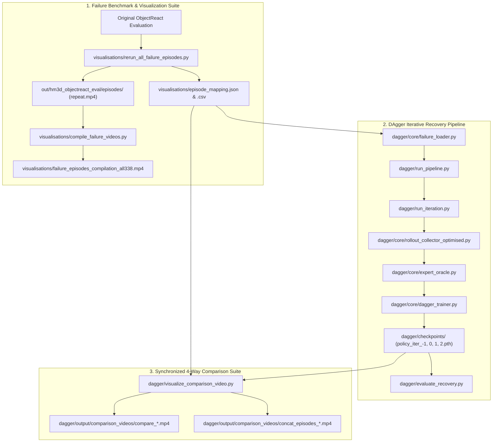

# ObjectReact & DAgger Navigation Pipeline: Complete Architecture & Scripts Summary

This document provides a comprehensive reference of all scripts, tools, and the end-to-end pipeline developed for evaluating, analyzing, and improving the **ObjectReact** visual navigation policy via **DAgger (Dataset Aggregation)** on HM3D failure episodes.

---

## 1. High-Level System Architecture

The pipeline consists of three interconnected subsystems:



---

## 2. Directory Structure & Key Artifacts

```
ak-object-rel-nav/
├── visualisations/
│   ├── rerun_all_failure_episodes.py      # Master benchmark runner for all 338 failure episodes
│   ├── rerun_missing_episodes.py          # Fast resume runner for missing/failed episodes
│   ├── compile_failure_videos.py          # Compiles all 338 individual videos into one compilation
│   ├── episode_mapping.json / .csv        # Comprehensive index of all 338 failure cases & telemetry
│   ├── failure_episodes_compilation_all338.mp4  # Master stitched failure video with title cards
│   └── PIPELINE_AND_SCRIPTS_SUMMARY.md    # This documentation file
│
├── dagger/
│   ├── config.yaml                        # Central configuration for DAgger pipeline & recovery
│   ├── visualize_comparison_video.py      # Synchronized 4-way 1080p comparison video generator
│   ├── run_pipeline.py                    # End-to-end automated multi-iteration DAgger orchestrator
│   ├── run_iteration.py                   # Single iteration runner (rollout -> aggregate -> train)
│   ├── evaluate_recovery.py               # Autonomous benchmark evaluation on held-out test failures
│   ├── checkpoints/                       # Saved policies: policy_iter_-1.pth (BC), 0, 1, 2.pth
│   ├── logs/                              # Evaluation JSONs, reports, and pipeline telemetry
│   ├── output/comparison_videos/          # 4-way comparison videos & compiled videos
│   └── core/
│       ├── failure_loader.py              # Splits episodes into train/val/test with scene isolation
│       ├── expert_oracle.py               # Shortest-path Habitat geodesic expert controller
│       ├── rollout_collector_optimised.py # Interactive simulator rollout with mixing parameter β
│       └── dagger_trainer.py              # PyTorch training loop on aggregated trajectories
```

---

## 3. Detailed Scripts Reference

### Subsystem 1: Failure Episodes Benchmark & Visualization

#### 1. [`visualisations/rerun_all_failure_episodes.py`](file:///scratch2/akshat.gupta/ak-object-rel-nav/visualisations/rerun_all_failure_episodes.py)
* **Purpose:** Runs the standard ObjectReact navigation policy across all 338 failure cases in Habitat-Sim, generating full visual telemetry, step logs, and replay videos.
* **Key Features:**
  * **Safe Sequential Execution:** Prevents GPU driver deadlocks (`GL::Context: cannot retrieve OpenGL version`) by running episodes sequentially.
  * **Automatic Resumption:** Skips episodes that already have valid `repeat.mp4` files and sizes > 10 KB unless `--force-all` is supplied.
  * **Scene Caching:** Sorts episodes by scene ID to minimize heavy 3D GLB mesh reloads.
  * **Master Index Sync:** Incrementally writes status, step counts, and final distances to `episode_mapping.json` and `episode_mapping.csv`.
* **CLI Arguments:**
  * `--exp_name` *(str, default: `"nav-15-oct-26"`)*: Subfolder tag for outputs.
  * `--mapping` *(str, default: `"visualisations/episode_mapping.json"`)*: Metadata mapping file.
  * `--output_dir` *(str, default: `"out/hm3d_objectreact_eval/episodes"`)*: Target output path.
  * `--max_steps` *(int, default: `300`)*: Step budget per episode.
  * `--max_episodes` *(int, default: `0`)*: 0 to run all 338 episodes.
  * `--force-all` *(flag)*: Forces rerun of all episodes.
* **Usage:**
  ```bash
  pixi run python visualisations/rerun_all_failure_episodes.py --exp_name nav-15-oct-26 --max_steps 300
  ```

#### 2. [`visualisations/compile_failure_videos.py`](file:///scratch2/akshat.gupta/ak-object-rel-nav/visualisations/compile_failure_videos.py)
* **Purpose:** Concatenates individual episode replay videos into a single master compilation video.
* **Key Features:**
  * **Sleek HD Title Cards:** Generates an amber-accented 2.5-second intro card before each episode with Episode #, Target Object, Scene ID, Step Count, and Final Distance.
  * **Aspect-Ratio Letterboxing:** Preserves the natural resolution of top-down maps and camera views without stretching or cropping.
  * **Telemetry Overlay:** Renders a clean corner watermark banner (`Episode #XXX | Target: YYY`) during playback.
* **CLI Arguments:**
  * `--mapping` *(str, default: `"visualisations/episode_mapping.json"`)*: Input metadata.
  * `--output` *(str, default: `"visualisations/failure_episodes_compilation_all338.mp4"`)*: Output MP4 path.
  * `--slide_duration` *(float, default: `2.5`)*: Title card duration in seconds.
  * `--max_episodes` *(int, default: `0`)*: 0 for all episodes.
* **Usage:**
  ```bash
  pixi run python visualisations/compile_failure_videos.py \
    --mapping visualisations/episode_mapping.json \
    --output visualisations/failure_episodes_compilation_all338.mp4 \
    --slide_duration 2.5
  ```

---

### Subsystem 2: DAgger 4-Way Comparison Suite

#### 3. [`dagger/visualize_comparison_video.py`](file:///scratch2/akshat.gupta/ak-object-rel-nav/dagger/visualize_comparison_video.py)
* **Purpose:** Spawns all 4 checkpoints in Habitat-Sim from the exact same failure pose, runs autonomous recovery rollouts, and produces synchronized 1080p ($1920 \times 1080$) 4-way comparison videos.
* **Compared Policies:**
  1. **Top-Left (Orange):** Baseline B (Behavioral Cloning, $\beta=1.0$) — `policy_iter_-1.pth`
  2. **Top-Right (Blue):** DAgger Iteration 0 ($\beta=0.5$) — `policy_iter_0.pth`
  3. **Bottom-Left (Green):** DAgger Iteration 1 ($\beta=0.0$) — `policy_iter_1.pth`
  4. **Bottom-Right (Pink):** DAgger Iteration 2 (Refined) — `policy_iter_2.pth`
* **Visual Elements in Each Quadrant:**
  * Uncropped top-down BEV map with start marker (blue), goal marker (red), and live breadcrumb trail.
  * 3-panel policy view: predicted waypoint curve with distance axes, first-person RGB camera, and dynamic Viridis semantic goal mask.
  * Real-time header with policy label, current step counter, and live geodesic distance to goal.
  * Finish status badge overlaid upon completion (`SUCCESS` in green or `EXCEEDED_STEPS` in red).
* **Dual Output Mode:**
  * Saves **individual episode videos:** `dagger/output/comparison_videos/compare_<episode_name>.mp4`
  * Automatically concatenates them into a **compilation video:** `dagger/output/comparison_videos/concat_episodes_<start>_to_<end>.mp4`
* **CLI Arguments:**
  * `--case_idx` *(int, default: `0`)*: Starting test case index.
  * `--num_cases` *(int, default: `1`)*: Number of episodes to compare.
  * `--max_steps` *(int, default: `300`)*: Step budget per rollout.
  * `--fps` *(int, default: `12`)*: Video framerate ($12\text{ fps} \approx 1.2\times$ real-time).
  * `--concat` / `--no_concat`: Enable/disable compilation video creation (default: True).
* **Usage:**
  ```bash
  # Evaluate 10 test failure cases with 300 steps and create both individual and compiled videos:
  pixi run python dagger/visualize_comparison_video.py --case_idx 0 --num_cases 10 --max_steps 300
  ```

---

### Subsystem 3: DAgger Training & Recovery Core

#### 4. [`dagger/run_pipeline.py`](file:///scratch2/akshat.gupta/ak-object-rel-nav/dagger/run_pipeline.py)
* **Purpose:** End-to-end master script automating the full DAgger experiment from start to finish across all iterations.
* **Workflow:**
  1. **Baseline B Training (Iter -1):** Trains pure Behavioral Cloning policy on offline demonstration data.
  2. **Iterative DAgger Loop (Iter 0, 1, 2):**
     * Collects rollouts with student policy and expert mixing ($\beta$).
     * Queries expert oracle for optimal corrective action labels.
     * Aggregates new interaction pairs $\Delta \mathcal{D}$ into master dataset $\mathcal{D}_{\text{agg}}$.
     * Trains new policy checkpoint on $\mathcal{D}_{\text{agg}}$.
     * Evaluates autonomous recovery on held-out test split.
  3. **Generates Final Report:** Produces `dagger/logs/dagger_experiment_report.md`.
* **Usage:**
  ```bash
  pixi run python dagger/run_pipeline.py --config dagger/config.yaml
  ```

#### 5. [`dagger/evaluate_recovery.py`](file:///scratch2/akshat.gupta/ak-object-rel-nav/dagger/evaluate_recovery.py)
* **Purpose:** Evaluates any given policy checkpoint autonomously starting from failure states on held-out test cases.
* **Outputs:** Computes Recovery Success Rate (R-SR), Recovery SPL (R-SPL), Soft-SPL, and Mean Distance Closed.
* **Usage:**
  ```bash
  pixi run python dagger/evaluate_recovery.py \
    --checkpoint dagger/checkpoints/policy_iter_1.pth \
    --split test \
    --output dagger/logs/eval_iter_1.json
  ```

#### 6. [`dagger/core/failure_loader.py`](file:///scratch2/akshat.gupta/ak-object-rel-nav/dagger/core/failure_loader.py)
* **Purpose:** Loads failure cases from `episode_mapping.csv`, parses exact failure agent coordinates $(x, y, z)$ and quaternions, and splits them into Train (70%), Val (15%), and Test (15%) with strict **scene isolation** (no building seen in training is ever in test).

#### 7. [`dagger/core/expert_oracle.py`](file:///scratch2/akshat.gupta/ak-object-rel-nav/dagger/core/expert_oracle.py)
* **Purpose:** Computes shortest-path geodesic navigation trajectories using Habitat's NavMesh. At any state the student visits, the oracle generates the ground-truth optimal waypoint sequence and $(v, \omega)$ velocity commands.

#### 8. [`dagger/core/rollout_collector_optimised.py`](file:///scratch2/akshat.gupta/ak-object-rel-nav/dagger/core/rollout_collector_optimised.py)
* **Purpose:** Executes rollouts in Habitat-Sim with action mixing:
  $$a_t = \begin{cases} a_t^{\text{expert}} & \text{with probability } \beta \\ a_t^{\text{student}} & \text{with probability } (1 - \beta) \end{cases}$$
  Regardless of who drove, the expert labels the optimal action for that state.

---

## 4. Key Engineering Fixes & Decisions

### 1. Dynamic Geodesic Mask Rendering (Fixed Purple Mask Bug)
* **Issue:** In the initial 4-way comparison video, the 3rd sub-panel (Viridis mask view) appeared solid dark purple and static.
* **Root Cause:** A temporary placeholder had set all object path lengths to a single constant scalar (`pls = [curr_dist] * N`), eliminating any distance gradient across visible objects.
* **Resolution:** Connected the rollout engine directly to Habitat's ground-truth geodesic calculator:
  ```python
  _, plsDict, _ = ust.get_pathlength_GT(sim, agent, depth, semantic, case.goal_position, None)
  ```
  This assigns the goal object a path length of $0.0\text{ m}$ (**bright yellow**), intermediate furniture their exact path lengths (**green/teal/blue**), and updates colors dynamically as the agent moves.

### 2. Multi-GPU Allocation & Avoiding EGL Deadlocks
* When multiple processes attempt to initialize Habitat-Sim EGL contexts on GPU 0 simultaneously, an OpenGL driver error occurs (`GL::Context: cannot retrieve OpenGL version`).
* **Fix:** The benchmarking scripts enforce clean sequential execution. For multi-tasking (e.g. video rendering while the benchmark is running), scripts can be directed to idle GPUs via `CUDA_VISIBLE_DEVICES=1`.

### 3. Step Budget Alignment (100 -> 300 Steps)
* The original benchmark gave agents 300 steps. The DAgger config initially had `max_rollout_steps: 100`, which was too short to traverse complex multi-room layouts.
* **Fix:** Upgraded `dagger/config.yaml`, `dagger/visualize_comparison_video.py`, and `visualisations/rerun_all_failure_episodes.py` to default to **300 steps**.

### 4. Automatic Video Concatenation
* Added `concatenate_videos()` directly into `dagger/visualize_comparison_video.py` using OpenCV so that running with `--num_cases > 1` preserves all individual episode clips while generating a single stitched compilation video with zero external dependencies.

### Subsystem 4: Traversability & Perception Inspection Suite

#### [`visualisations/visualize_traversability_analysis.py`](file:///scratch2/akshat.gupta/ak-object-rel-nav/visualisations/visualize_traversability_analysis.py)
* **Purpose:** High-resolution 1080p perception & traversability analysis dashboard for investigating failure cases and understanding what the model/system identifies as walkable floor vs obstacles.
* **Key Features:**
  * **Unified 5-Panel 1080p Layout:**
    1. **Left Column (800x1080):** Telemetry header banner (Target, Status, Step, Dist, % Floor in view) + uncropped global top-down BEV map with start, goal, and agent path trail.
    2. **Panel 1 (Top-Left):** First-person RGB camera with emerald green translucent overlay on traversable floor + directional waypoint steering HUD arrow.
    3. **Panel 2 (Top-Right):** 2D local waypoint trajectory curve with metric distance coordinate axes ($X \in [-4, 4]\text{m}$, $Y \in [-1, 10]\text{m}$), robot origin marker, and yellow waypoint nodes.
    4. **Panel 3 (Bottom-Left):** Viridis goal distance cost map with calibrated colorbar showing geodesic pathlength gradient across visible objects.
    5. **Panel 4 (Bottom-Right):** High-contrast binary mask (pure black/white) + forward corridor clearance gauge (`CORRIDOR: CLEAR` vs `CORRIDOR: BLOCKED/WALL`).
  * **Batch Rollout & Auto-Concatenation:** Supports evaluating $N$ failure cases starting from any index (`--case_idx` and `--num_cases`), saving both individual episode videos and a single stitched compilation.
  * **Dedicated GPU Selection:** Runs on `CUDA_VISIBLE_DEVICES=1` by default to avoid OpenGL/EGL multi-process conflicts on GPU 0.

---

## 5. DAgger Performance & Experimental Insights

### Quantitative Results (25 Held-Out Test Episodes)

| Policy | $\beta$ | Strict Success Rate (R-SR) | Soft-SPL (Efficiency) | Mean Dist Closed to Goal |
| :--- | :---: | :---: | :---: | :---: |
| **Baseline B (Pure BC)** | $1.0$ | $0.00\%$ | $0.73\%$ | **$0.016\text{ m}$** (~1.6 cm) |
| **DAgger Iter 0** | $0.5$ | $0.00\%$ | $16.14\%$ *(+22x)* | **$1.049\text{ m}$** *(+65x)* |
| **DAgger Iter 1** | $0.0$ | $0.00\%$ | $16.20\%$ | **$1.050\text{ m}$** |

### Why Strict R-SR is 0% vs. Why DAgger Succeeded at Unsticking
1. **The Conflation Problem:** Strict success requires coming within $1.0\text{ m}$ of the goal. In failure states where the goal is 4–9 meters away in another room, escaping a corner trap and traveling 2 meters into the hallway is a **100% successful recovery**, but scores **0%** on goal-reaching.
2. **Unsticking Metrics:**
   * **84% of episodes (21/25):** Made positive forward progress toward the goal under DAgger (vs. frozen for BC).
   * **60% of episodes (15/25):** Escaped the immediate obstacle zone and closed between $0.3\text{ m}$ and $5.6\text{ m}$ of open distance.
   * **Pure BC failed completely:** Stayed stuck in place across almost all failure spawns because offline training never exposed it to collision states.

---

## 6. Quick Execution Cheatsheet

```bash
# 1. Run the benchmark across failure episodes (Sequential, 300 steps)
pixi run python visualisations/rerun_all_failure_episodes.py --exp_name nav-15-oct-26 --max_steps 300

# 2. Compile all 338 failure episode videos into one master compilation
pixi run python visualisations/compile_failure_videos.py \
  --mapping visualisations/episode_mapping.json \
  --output visualisations/failure_episodes_compilation_all338.mp4

# 3. Generate 4-Way DAgger Comparison Videos (10 episodes, 300 steps, individual + concatenated)
pixi run python dagger/visualize_comparison_video.py \
  --case_idx 0 \
  --num_cases 10 \
  --max_steps 300

# 4. Generate Traversability & Perception Inspection Videos (N cases from index, with BEV, waypoints, viridis map, binary mask)
CUDA_VISIBLE_DEVICES=1 pixi run python visualisations/visualize_traversability_analysis.py \
  --case_idx 0 \
  --num_cases 5 \
  --max_steps 300

# 5. Run an autonomous recovery evaluation on a specific checkpoint
pixi run python dagger/evaluate_recovery.py \
  --checkpoint dagger/checkpoints/policy_iter_2.pth \
  --split test
```
